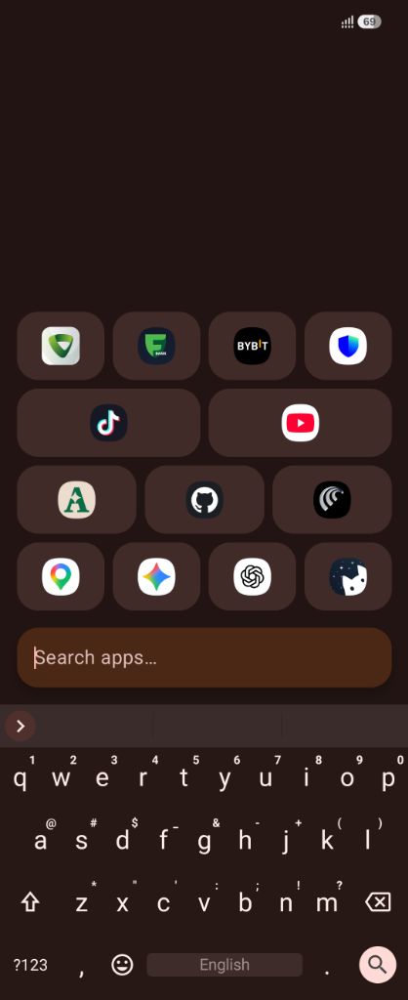

# Home

A minimalist Android home screen written in Kotlin for Android 11+ (API 30+).

<p align="center">
  
</p>

## Features

- **Minimalist Jetpack Compose UI**: Built entirely with Jetpack Compose. Edge-to-edge layout where pinned apps smoothly scroll under the status bar and behind the floating search bar, which sits directly above the keyboard.
- **Fuzzy Search**: Tolerates typos and partial queries; press Enter to launch the top match.
- **Pinned Apps & Groups**: Long-press in search to pin/unpin. Drag-and-drop to reorder favorites, merge up to 4 apps into a single grouped row, or extract an app from a group, with fluid physics-based spring animations.
- **Notification Shade Gesture**: Swipe down anywhere over the pinned apps list to quickly open the system notification shade.
- **Resilient Work Profile Support**: Seamless multi-profile support with work badges and isolated launching. Pinned apps and group structures from locked or paused profiles are safely preserved and restored.
- **Instant Launch & Smart Caching**: Asynchronous app discovery with multi-tier on-demand icon caching (memory LRU and disk cache) to eliminate startup stutter and prevent icon pop-in.
- **Material You**: Dynamic colors on Android 12+; follows system light/dark theme.
- **Privacy-First**: No internet access, no ads, and no `QUERY_ALL_PACKAGES` permission.

## Building & Testing

Requires JDK 17 and Android SDK 35.

```sh
./gradlew assembleDebug
```

Or using the build helper script:

```sh
./scripts/build.sh
```

The APK will be at `app/build/outputs/apk/debug/app-debug.apk`.

### Unit Tests & Lint

Run the test suite and static analysis:

```sh
./gradlew testDebugUnitTest lintDebug
```

Unit tests and lint also run automatically via a Git pre-commit hook. Install it once after clone:

```sh
./scripts/install-hooks.sh
```

## Installation

### F-Droid

[](https://f-droid.org/packages/su.myt.home/)

### Manual (ADB)

1. Build and install via helper script (requires connected device/emulator):
   ```sh
   ./scripts/install.sh
   ```
   Or install the built APK manually:
   ```sh
   adb install -r app/build/outputs/apk/debug/app-debug.apk
   ```
2. Set **Home** as your default launcher in **Settings → Apps → Default apps → Home app**.
